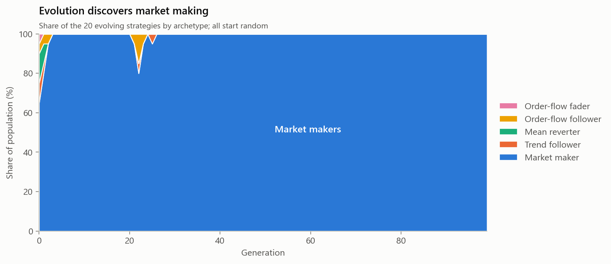

# Beaglex

An agent-based market simulator in C++20 for studying how trading strategies
co-evolve inside a realistic limit order book.

**What this is:** a research platform in the tradition of the Santa Fe
Artificial Stock Market and JPMorgan's ABIDES: a matching engine, a population
of trading agents, and a genetic algorithm that evolves their strategies, used
to ask questions about *market behaviour* (herding, liquidity, crashes, arms
races between strategies).

**What this is not:** a money-making trading bot. Strategies that do well here
are exploiting a simulated market; that says nothing about real-world
profitability. See [Limitations](#limitations).

## Try it in your browser

**[Market playground →](https://amalrtms.github.io/beaglex/)** The full engine,
compiled to WebAssembly, runs a live trading day in the page. Unleash identical
or diverse trading algorithms, add the evolved market maker, trigger news shocks,
switch circuit breakers on and off, and watch the order book, prices and each
trader type's profit react. The Evolution view replays the Phase 5 runs
generation by generation, explains each generation's best genome in plain words,
and releases it into the live market.

To run it locally (needs the [Emscripten SDK](https://emscripten.org/docs/getting_started/downloads.html)
on PATH and Node 22):

```bash
cd web
npm install
npm run build:wasm
npm run dev
```

The evolution view's data (`web/src/data/evolution.json`) is generated by
`beaglex_export_evolution`, run from the repository root.

## Key findings

1. **The simulated market behaves like a real one.** On 50 out-of-sample days it
   reproduces six stylized facts of real returns (fat tails, volatility
   clustering and others) that a random-walk control does not, so they emerge
   from agent interaction. [Validation](docs/validation.md)
2. **Evolution rediscovers market making.** Strategies evolved from random
   genomes converge on tight, fast, inventory-averse quoting, which is how real
   market makers operate, and their competition drives the spread to its
   one-tick minimum. [Evolution](docs/evolution.md)
3. **A few identical algorithms can destabilise the market.** Between 10 and 20
   copies of a trend-chasing algorithm, under 2% of volume, the market tips from
   mostly stable to dislocated every day. Giving the same number of algorithms
   diverse signals cuts volatility by 2.7x: **herding** is the hazard.
   [Experiments](docs/experiments.md#1-how-much-algorithmic-trading-can-the-market-absorb)
4. **Circuit breakers can backfire.** Price bands with a lagged reference make
   the algorithm-driven market four times as volatile. Adding trading halts
   contains volatility somewhat, at the cost of halting trading for over half the
   day. [Experiments](docs/experiments.md#2-do-circuit-breakers-help)
5. **Adaptive markets grow their own defences.** With trend-chasing algorithms
   present, evolution produces their mirror image, mean-reverting predators, which
   cut volatility from 149 bp to about 8 bp while competing their own profits
   away. [Experiments](docs/experiments.md#3-predator-and-prey)

All results come with confidence intervals, held-out or out-of-sample tests, and
stated limitations.

## Project phases

| Phase | Scope | Write-up |
|---|---|---|
| 1 | Matching engine: limit / market / IOC, cancel, modify, price-time priority | [below](#matching-engine) |
| 2 | Latency & throughput benchmarks, data-structure optimisation | [benchmarks.md](docs/benchmarks.md) |
| 3 | Discrete-event market simulation with latency, fees and four agent types | [simulation.md](docs/simulation.md) |
| 4 | Validation against empirical stylized facts | [validation.md](docs/validation.md) |
| 5 | Co-evolution of interpretable trading strategies | [evolution.md](docs/evolution.md) |
| 6 | Experiments: algorithmic share, herding, circuit breakers, predator and prey | [experiments.md](docs/experiments.md) |

## Market simulation

A discrete-event simulation of a full trading day: 152 agents of four types
(market makers, noise traders, momentum traders and value traders) trade through
the matching engine. Prices emerge from their interaction around a hidden
fundamental value that only value traders can estimate.

- **Latency everywhere**: orders, fill reports and market data are all delayed
  by each agent's distance from the exchange (100 µs to 20 ms).
- **Realistic fees**: 0.30¢ taker fee, 0.20¢ maker rebate.
- **Deterministic**: one seed reproduces the entire day trade for trade.
- **Fast**: a 6.5 hour day (1–1.6M events) simulates in a quarter to half a second.


Model, agents, calibration and limitations: [docs/simulation.md](docs/simulation.md).

## Validation: does it behave like a real market?

Real asset returns share well-documented statistical regularities, the
*stylized facts* (Cont 2001). On 50 out-of-sample simulated days, Beaglex
reproduces all six tested, while a control series (the hidden fundamental, a
Gaussian random walk) shows none. So the facts **emerge from agent
interaction** rather than being fed in.

| Stylized fact | Simulated price | Control | Real markets |
|---|---:|---:|---|
| No return autocorrelation (max \|ACF\|, 1–10 min) | 0.030 | 0.017 | ≈ 0 |
| Fat tails (excess kurtosis, 1 min) | 3.27 | -0.02 | > 0 |
| Tail index (Hill) | 3.60 | 5.56 | 2–5 |
| Aggregational Gaussianity (kurtosis 1 → 30 min) | 3.27 → -0.31 | flat | decreasing |
| Volatility clustering (ACF of \|r\|, lags 1–10) | 0.140 | 0.001 | > 0, slow decay |
| Volume–volatility correlation | 0.366 | n/a | > 0 |


Ablations show which mechanism produces which fact. Self-exciting order flow
drives fat tails and clustering, liquidity withdrawal makes clustering persist,
and market makers dampen volatility. The model first failed this validation
(3 of 6); the write-up covers how it was diagnosed and fixed, an overfitting
check, and what is still unrealistic: [docs/validation.md](docs/validation.md).

## Evolving strategies

A genetic algorithm evolves a population of 20 trading strategies inside the
validated market. Each strategy is an **interpretable genome** of ten named
genes: signal weights (trend, short-term reversion, order-flow imbalance,
inventory), a trading threshold, aggression, size, speed, and a switch between
directional trading and two-sided quoting. Strategies are uninformed: they see
delayed market data, never the fundamental value. The population **co-evolves**,
trading together against the background agents and each other, on fresh market
days every generation.



From random starting points, three independent runs all converge on the same
strategy: **a fast, tight market maker** that quotes at the minimum spread,
leans hard against its inventory, and shifts its quotes toward short-term price
moves and order-flow imbalance. That is how real market makers manage inventory
and adverse-selection risk, and none of it was programmed in. Competition among
the evolved market makers then drives the whole market's spread from about 2.1
ticks to its 1-tick minimum and competes their profits away.

On 10 held-out days, 16–18 of 20 evolved strategies are profitable, against 8–10
of the random starting population. Average profit does not reliably improve:
the gains go to other traders as tighter spreads. Details, the design flaws
found along the way, and limitations: [docs/evolution.md](docs/evolution.md).

## Experiments: algorithms and market stability

Controlled experiments with a paired design: every condition runs on the same 20
market days, with 95% confidence intervals.


- **Algorithmic share.** Adding fast trend-chasing algorithms produces a tipping
  point between 10 and 20 copies, at under 2% of volume. Adding the evolved
  market-making algos instead cuts the spread from 2.5 to 1 tick while volatility
  stays roughly flat.
- **Herding.** The same number of algorithms with diverse signals does a
  fraction of the damage of identical copies (65 vs 174 bp volatility at 20).
- **Circuit breakers.** Price bands alone amplify the runaway about fourfold;
  bands with 5-minute halts cut volatility about 20% but halt trading for over
  half the day.
- **Predator and prey.** Evolution in a market full of trend chasers produces
  mean-reverting predators that bring volatility from 149 bp back to near
  normal.


Full results, mechanisms and caveats: [docs/experiments.md](docs/experiments.md).

## Performance

On a realistic synthetic order flow (2M operations, ~8,600 resting orders),
single core of an Intel i7-14650HX laptop:

| Book | Throughput | p50 | p99 | p99.9 |
|---|---:|---:|---:|---:|
| Baseline (`std::map` / `std::list` / `std::unordered_map`) | 6.1 M ops/s | 153 ns | 560 ns | 930 ns |
| Optimised `OrderBook` | **15.2 M ops/s** | **68 ns** | **205 ns** | **330 ns** |

**2.5x throughput and 2.7x lower p99 latency**, with zero heap allocation on
the hot path. The gain came from four measured steps: a reused trade buffer, a
pooled intrusive order queue, a custom open-addressing hash index, and
contiguous price levels. Method, workload, per-step results and caveats are in
[docs/benchmarks.md](docs/benchmarks.md).

## Matching engine

- **Price-time priority**: best price first, then first-in-first-out within a price level.
- **Trades execute at the resting (maker) order's price.**
- **Integer tick prices**: no floating point anywhere in the book.
- **Order types**: Limit (remainder rests), Market (remainder discarded), IOC.
- **Modify semantics** match real venues: reducing size keeps queue position;
  changing price or increasing size is a cancel/replace that loses priority.
- **Deterministic**: priority comes from arrival order, not wall-clock time, so a
  given input sequence always yields identical trades. This matters for
  reproducible simulation experiments.

Two implementations share one interface. `OrderBook` is the optimised engine.
`BaselineOrderBook` is the original straightforward version, kept as the
benchmark reference and as a second implementation for testing.

## Correctness

Both books are **differentially fuzzed** against a deliberately naive
reference book ([`tests/reference_book.hpp`](tests/reference_book.hpp)) that
linearly scans every order on every match. All receive the same random stream
of submits, cancels and modifies (including invalid ones), and every result,
trade and book level must match after every operation. Two fuzz profiles run:
a narrow price band where the book crosses constantly, and a wide one that grows
the book to thousands of orders across hundreds of levels. The fuzz test also
checks that the book is never left crossed. The custom hash index has its own
differential test against `std::unordered_map`.

The fuzz tests were checked by planting a bug (trades priced at the taker's
price instead of the maker's); it was caught within 22 operations.

## Building (Windows, MSVC)

Requires Visual Studio 2022+ or Build Tools with the C++ workload (includes CMake and Ninja).

```powershell
.\build.ps1                          # Release build: library, demo, tests, benchmark
.\build.ps1 -NoTests                 # skip GoogleTest (no download)
.\build\release\beaglex_demo.exe     # walk through a sweep and a market order
.\build\release\beaglex_tests.exe    # unit + fuzz tests
.\build\release\beaglex_bench.exe    # throughput and latency comparison
.\build\release\beaglex_sim.exe --seed 1 --out out   # simulate a day; writes CSVs to out/
.\build\release\beaglex_validate.exe --days 50 --seed 1001   # stylized-facts scorecard
python scripts\plot_validation.py    # charts from the validation CSVs (needs matplotlib)
.\build\release\beaglex_evolve.exe --generations 100   # evolve strategies; writes out/evolution/
python scripts\plot_evolution.py     # charts from the evolution CSVs
.\build\release\beaglex_experiment.exe algo-share   # also: herding, circuit-breakers
.\build\release\beaglex_evolve.exe --generations 60 --fixed-momentum 20 --out out\predators
python scripts\plot_experiments.py   # charts from the experiment CSVs
```

## Limitations

Stated up front so results are read in the right light:

- Single instrument, single venue, one day at a time; no cross-venue effects or hidden/iceberg orders.
- No real market data; the agents generate all order flow, and parameters are
  calibrated against stylized facts rather than fitted to real data.
- Agents are simplified models of real participants. Fees and latency are modelled, but only approximately.
- Simulated tails are milder and volatility clustering shorter-lived than in real
  markets (see [validation](docs/validation.md#limitations)).
- Benchmarks measure the matching engine alone, on a synthetic workload.
- Experiment results describe mechanisms in a simplified market, not real-world
  magnitudes; the circuit-breaker model is a simplification of the real rule.

## Layout

```
include/beaglex/      public headers (OrderBook, BaselineOrderBook, types)
include/beaglex/sim/  simulation: event loop, agents, population
include/beaglex/analysis/  return statistics and stylized-facts tests
include/beaglex/evo/  genomes, evolved trader, genetic algorithm
src/                  implementations
apps/demo.cpp         walk-through of a sweep and a market order
apps/sim.cpp          run a simulated trading day, write CSVs
apps/validate.cpp     stylized-facts validation and ablation runs
apps/evolve.cpp       evolve strategies and test them on held-out days
apps/experiments.cpp  algorithmic share, herding and circuit-breaker experiments
scripts/              chart generation (Python)
bench/                workload generator and benchmark
tests/                unit, fuzz, simulation, statistics and evolution tests
docs/                 benchmark, simulation, validation, evolution and experiment write-ups
```
