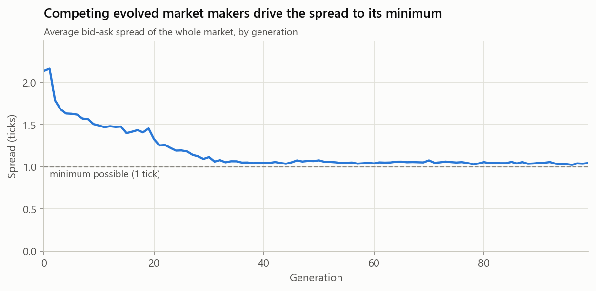
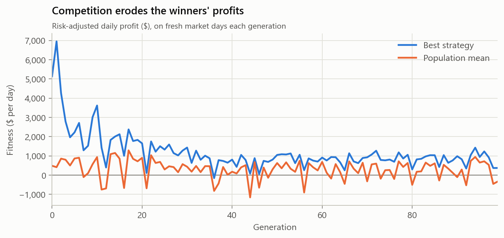

# Evolving trading strategies

Which trading strategies succeed in this market? Instead of designing them,
Beaglex evolves them: a population of strategies trades in the
[validated](validation.md) simulated market, and a genetic algorithm breeds
more of whatever earns the best risk-adjusted profit.

The point is to study **what emerges and how it changes the market**, not to
find a strategy that makes money. Strategies that win here are exploiting a
simulated market, which says nothing about real-world profitability.

## Interpretable genomes

Each strategy is a vector of ten bounded genes, each with a direct meaning, so
evolved strategies can be read and explained rather than treated as black boxes.

| Gene | Range | Meaning |
|---|---|---|
| `w_momentum` | -1 … 1 | Weight on the trend signal: 1-minute vs 10-minute moving average |
| `w_reversion` | -1 … 1 | Weight on price stretched above or below its 1-minute average |
| `w_imbalance` | -1 … 1 | Weight on top-of-book size imbalance (more bids than asks, or the reverse) |
| `w_inventory` | -1 … 1 | Weight on its own position; negative leans against inventory |
| `threshold` | 0.05 … 2 | Score needed before trading directionally |
| `aggression` | 0 … 1 | Probability of taking liquidity rather than joining the best price |
| `lots` | 1 … 5 | Order size (100-share lots) |
| `log10_interval_s` | 0 … 2.1 | Decision interval, 1 second to about 2 minutes |
| `quote_mode` | 0 … 1 | Above 0.5: quote both sides (market making) instead of trading directionally |
| `half_spread` | 0.5 … 5 | In quoting mode: ticks either side of a centre shifted by the score |

The **score** is the weighted sum of four signals, each scaled to roughly
[-3, 3]. A directional strategy buys above `+threshold` and sells below
`-threshold`. A quoting strategy keeps a bid and an ask around the price, leaning
both quotes by the score.

Evolved traders are **uninformed**. They see what any trader without inside
information sees, delayed by their 5 ms latency: top of book, last trade and
their own position. They never see the fundamental value. They hold at most
500 shares and pay the same fees as everyone else.

## The genetic algorithm

- **Co-evolution.** All 20 strategies trade together in the same market, with
  the 152 background agents. Each strategy's environment includes the other
  evolving strategies.
- **Fitness** = mean daily profit − 0.5 × standard deviation of daily profit,
  over 4 market days. A closing position is charged one tick per share to
  liquidate.
- **Fresh days every generation**, so strategies cannot memorise one day.
- **Selection.** The 4 best survive unchanged (elitism). The rest are offspring
  of tournament winners (best of 3), with uniform crossover (70%) and Gaussian
  mutation (each gene with probability 0.2, step 10% of its range).
- **Held-out test.** After evolution, the initial random population and the
  final evolved population are each run on 10 market days never used during
  evolution.

Days within a generation run in parallel threads. Results are gathered by
index, so a run is fully reproducible from its seed. A 100-generation run takes
a few minutes on a laptop.

## Results

### Evolution discovers market making

From a random start, every run tried (seeds 1, 2 and 3) converges within about
5 generations to a population made up entirely of market makers, and stays there.


All three runs evolve the same strategy. Top strategies on held-out days, seed 1:

| | w_momentum | w_reversion | w_imbalance | w_inventory | lots | interval | quote_mode | half_spread |
|---|---:|---:|---:|---:|---:|---:|---:|---:|
| #1 | -0.13 | 0.93 | 0.33 | -1.00 | 4.6 | 1 s | 1.00 | 0.5 |
| #2 | -0.06 | 1.00 | 0.56 | -1.00 | 4.7 | 1 s | 0.90 | 0.5 |
| #3 | -0.06 | 1.00 | 0.18 | -1.00 | 4.6 | 1 s | 1.00 | 0.5 |

Read gene by gene, the evolved strategy:

- **Quotes both sides as tightly as allowed** (half-spread at its 0.5 tick
  minimum, giving a one-tick market) to win the queue and the maker rebate.
- **Requotes as fast as allowed** (every second), so its quotes are rarely stale.
- **Leans hard against its own inventory** (`w_inventory` at -1, its bound),
  shading quotes to shed risk. This is the core idea of optimal market-making
  models such as Avellaneda & Stoikov (2008).
- **Shifts its quotes toward short-term price moves and order-flow imbalance**
  (`w_reversion` ≈ +1, `w_imbalance` > 0). It raises its quotes when the price
  has just risen or when bids outweigh asks, protecting itself from being picked
  off by better-informed flow (adverse selection).

None of this was written into the trader. The genome allows many strategies,
and this is the one that wins here.

### Competition tightens the market and erodes profits



As evolved market makers compete for the same flow, they keep shaving their
quotes. The whole market's spread falls from about 2.1 ticks to just above the
one-tick minimum, and keeps narrowing for about 30 generations after the
population is already all market makers. Evolution is still refining the
strategy, not just choosing its type.



The best strategy's profit falls from about $5,000–7,000 a day early on to
about $1,000. Once everyone runs the winning strategy, its profits are competed
away: the usual economics of a contestable market.

### Held-out test

10 market days never used in evolution:

| | Seed 1 initial | Seed 1 evolved | Seed 2 initial | Seed 2 evolved | Seed 3 initial | Seed 3 evolved |
|---|---:|---:|---:|---:|---:|---:|
| Strategies with positive fitness (of 20) | 8 | **18** | 9 | **18** | 10 | **16** |
| Mean fitness ($/day) | 497 | 442 | 156 | 385 | 482 | 475 |
| Market spread (ticks) | 2.12 | **1.05** | 2.42 | **1.04** | 2.28 | **1.09** |
| Evolved share of volume | 14% | 37% | 7% | 37% | 11% | 36% |

What generalises is **reliability**: almost every evolved strategy is
profitable on unseen days, where only about half of the random ones were. The
**average** profit does not reliably improve. The random populations include a
few strategies that happen to do well against the background agents. Once all
twenty evolved strategies are market makers, they compete with each other, and
the extra profit is passed on to other traders as a tighter spread.

## Design decisions found by testing

Three problems showed up in early runs and changed the design:

1. **A biased starting population.** At first, quoting mode switched on when
   `half_spread` ≥ 1, which put 5/6 of random genomes into market making before
   any selection. A separate `quote_mode` switch now makes it a fair coin
   (checked by a test).
2. **Market makers that crossed the market.** Quotes leaned by a large score
   could put a "bid" above the best ask, turning a market maker into an
   aggressive taker. Quotes are now post-only, as market makers use on real
   venues, capped one tick inside the opposite side.
3. **Algorithms that overwhelm the market.** With 40 evolved strategies of up
   to 1,000 shares each, populations of fast trend and order-flow followers
   sometimes appeared and drove the price from $100 to $62 and back to $134
   within one simulated day. That is a real phenomenon (fast feedback trading
   has been linked to events like the May 2010 Flash Crash), but it is a
   different question. The baseline uses 20 strategies at 500 shares, and
   market stability as a function of algorithmic share is a Phase 6 experiment.

## Limitations

- **Early convergence.** Every run collapses to one archetype within about five
  generations. That could be the true optimum here or premature convergence;
  diversity-preserving methods (niching, speciation) would tell them apart.
- **Fitness is noisy.** Four days per generation leaves a lot of luck in each
  evaluation, visible in the jagged fitness curves.
- **Post-only is enforced against the strategy's own (5 ms stale) view**, not
  by the exchange, so a quote can still occasionally cross.
- **A small strategy space.** Ten genes and four signals; no learning within a
  day, no memory beyond two moving averages.
- **One instrument, short horizons.** Strategies trade intraday and are judged
  over a handful of days.

## Reproducing

```powershell
.\build\release\beaglex_evolve.exe --generations 100 --seed 1   # writes out/evolution/
python scripts\plot_evolution.py
```

Options: `--population N`, `--days N` (per generation), `--risk-aversion X`, `--out DIR`.
