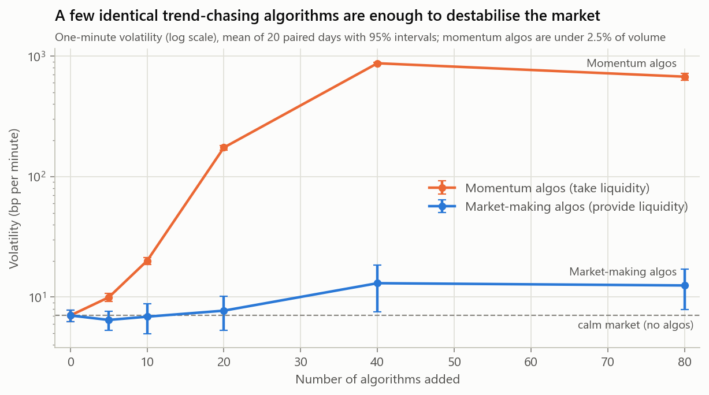
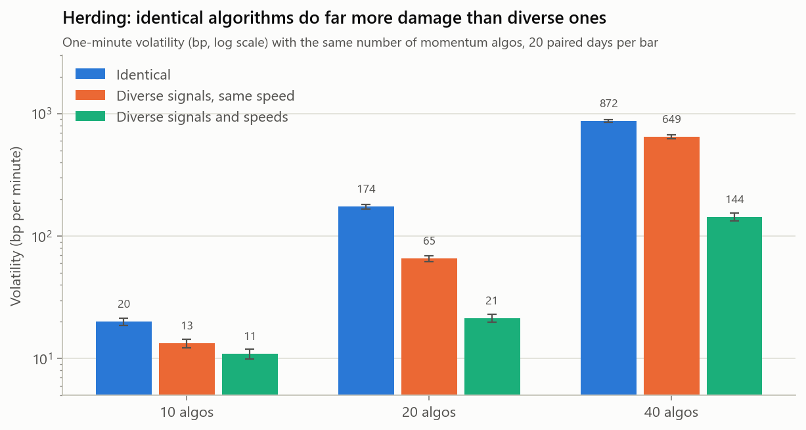
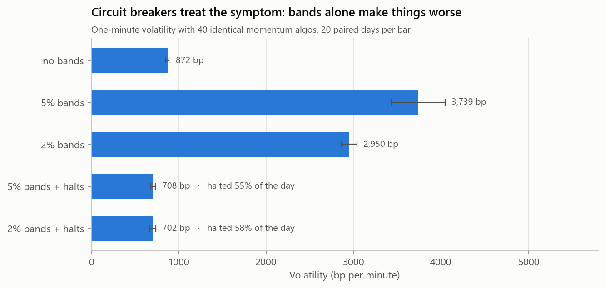
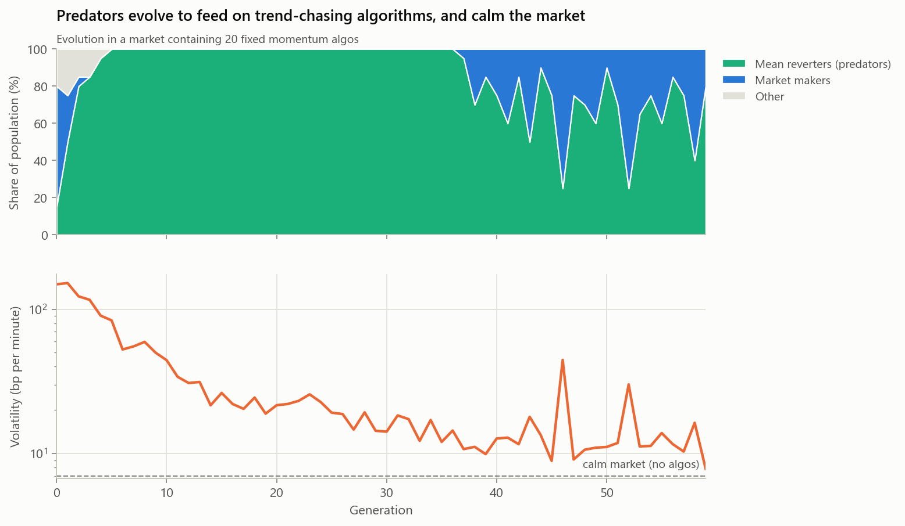

# Experiments

Three experiments on the [validated](validation.md) market, about one theme:
**how algorithmic trading strategies affect market stability, and how a market
of adaptive strategies responds.**

## Method

- **Paired design.** Every condition in experiments 1 and 2 runs on the same 20
  market days (seeds 5001–5020), so differences between conditions come from the
  treatment, not from different luck.
- **Outcomes fixed in advance:** one-minute volatility; average and maximum
  distance between price and fundamental value; share of days with a
  **dislocation** (price more than 2% from value at some point); spread; and the
  injected algorithms' own profit and share of volume.
- **95% confidence intervals** across days (± in tables, error bars in charts).
- **Algorithms tested** ([`presets.hpp`](../include/beaglex/evo/presets.hpp)):
  - **Momentum algo:** a fast trend chaser. It decides every second, buys
    strength and sells weakness, leans into order-flow imbalance, takes liquidity
    with immediate-or-cancel orders, and holds at most 500 shares.
  - **Market-making algo:** the strategy evolved in [Phase 5](evolution.md),
    which quotes both sides at a one-tick spread and leans against its inventory.

News jumps in the fundamental stay on, as in a real market. Reproduce with:

```powershell
.\build\release\beaglex_experiment.exe algo-share
.\build\release\beaglex_experiment.exe herding
.\build\release\beaglex_experiment.exe circuit-breakers
.\build\release\beaglex_evolve.exe --generations 60 --fixed-momentum 20 --out out\predators
python scripts\plot_experiments.py
```

## 1. How much algorithmic trading can the market absorb?

Add N copies of one algorithm to the normal market of 152 agents.



| Momentum algos | Volatility (bp) | Avg distance from value (bp) | Dislocated days | Their volume share | Their profit ($/day each) |
|---:|---:|---:|---:|---:|---:|
| 0 | 7.0 ± 0.8 | 6.9 | 0% | 0% | 0 |
| 5 | 9.9 ± 0.8 | 8.7 | 0% | 0.5% | -2,031 |
| 10 | 20.0 ± 1.4 | 14.5 | 20% | 0.9% | -6,170 |
| 20 | 174 ± 8 | 124 | 100% | 1.9% | -83,317 |
| 40 | 872 ± 19 | 1,350 | 100% | 2.0% | -264,105 |
| 80 | 675 ± 47 | 1,671 | 100% | 2.3% | -89,485 |

| Market-making algos | Volatility (bp) | Spread (ticks) | Dislocated days | Their volume share | Their profit ($/day each) |
|---:|---:|---:|---:|---:|---:|
| 0 | 7.0 ± 0.8 | 2.53 | 0% | 0% | 0 |
| 5 | 6.5 ± 1.1 | 1.18 | 5% | 30% | 1,995 |
| 10 | 6.9 ± 1.9 | 1.06 | 10% | 35% | 1,533 |
| 20 | 7.7 ± 2.4 | 1.03 | 25% | 39% | 561 |
| 40 | 13.0 ± 5.5 | 1.01 | 25% | 41% | -396 |
| 80 | 12.5 ± 4.6 | 1.01 | 10% | 41% | -792 |

**Findings**

- **A tipping point, not a gradual decline.** Between 10 and 20 identical
  momentum algos, the market goes from dislocated on one day in five to
  dislocated every day, and volatility rises almost ninefold. At that point the
  algos account for **under 2% of trading volume**. Their influence comes from
  acting in unison at the moment liquidity is thin, not from their size.
- **The destabilising algos lose money**, heavily, mostly to value traders who
  buy their overshoots back. A market that selects strategies by profit, as
  Phase 5 does, removes them. The danger is in the period before selection
  catches up.
- **Liquidity-providing algos are different in kind.** Even a few cut the spread
  from 2.5 ticks to about 1. Volatility stays flat up to 20 of them. With 40 or
  more it roughly doubles and dislocated days appear, but the intervals are wide,
  so this is weak evidence. Their profits are competed to zero by 20.

## 1b. Algorithms, or identical algorithms?

Momentum algos in experiment 1 are copies: same signal, same threshold, same
clock. Is the damage from algorithmic trading, or from **herding**? Three
populations of equal size:

- **identical** copies;
- **diverse signals, same speed:** each algo gets its own trend weights (0.5–1),
  flow weight (0–0.5) and threshold (0.3–1.5), but all still decide every second;
- **diverse signals and speeds:** the same, plus decision intervals of 1–30 seconds.



| Algos | Identical | Diverse signals, same speed | Diverse signals and speeds |
|---:|---:|---:|---:|
| 10 | 20.0 bp (20% dislocated) | 13.3 bp (45%) | 10.9 bp (10%) |
| 20 | 174 bp (100%) | **65 bp** (100%) | 21 bp (35%) |
| 40 | 872 bp (100%) | 649 bp (100%) | 144 bp (100%) |

**Findings**

- **Herding is a large part of the damage.** At 20 algos with the same speed and
  almost the same volume share (1.8% vs 1.9%), diversity of signals alone cuts
  volatility from 174 to 65 bp.
- **Desynchronising the algos cuts it much further**, to 21 bp. Part of that
  effect is simply less activity (volume share 1.2%), so it is not pure herding.
- **Diversity delays the tipping point but does not remove it.** At 40 algos
  every population dislocates the market.
- One result runs against the trend: at 10 algos, diverse-same-speed algos give
  lower volatility but more dislocated days than identical ones (45% vs 20%).

## 2. Do circuit breakers help?

US equity markets use **limit up–limit down** (LULD): trades may not print
outside price bands around a recent reference price, and if the market stays
at a band, trading pauses for five minutes. The simulator implements a
simplified version:

- **Bands:** buy prices are capped and sell prices floored at ±width around the
  mid of 5 minutes earlier. Market orders become immediate-or-cancel orders at the band.
- **Halts (optional):** an order that would trade against a market already
  beyond the band triggers a 5-minute pause instead, during which new orders are
  rejected.



| 40 momentum algos | Volatility (bp) | Avg distance from value (bp) | Spread (ticks) | Halts per day |
|---|---:|---:|---:|---:|
| No bands | 872 ± 19 | 1,350 | 2.8 | 0 |
| 5% bands | 3,739 ± 306 | 2,143 | 6.6 | 0 |
| 2% bands | 2,950 ± 89 | 1,962 | 6.4 | 0 |
| 5% bands + halts | 708 ± 27 | 1,458 | 8.4 | 42.7 |
| 2% bands + halts | 702 ± 35 | 1,366 | 11.2 | 45.5 |

In the normal market (no momentum algos) every variant is indistinguishable
from no bands, with at most 0.1 halts a day.

**Findings**

- **Bands alone make an algorithm-driven market worse**, about four times as
  volatile. This is not an artefact of measuring the mid price: volatility from
  executed trade prices rises by a similar factor (996 to 4,298 bp on a sample
  day). The mechanism is delayed feedback. The band's reference trails the
  market by five minutes, so once the price runs past it, new bids are repriced
  to the band edge, the book becomes lopsided, and trades jump to the band edge
  when sellers arrive. On a sample day the bands adjusted 455,000 orders
  (repriced, or market orders converted to band-limited ones), mostly from
  noise traders, market makers and the momentum algos. The value traders, which
  were first expected to be the ones blocked, accounted for only 18,000.
- **Bands with halts reduce volatility by about 20% but do not restore the
  market.** Price stays as far from value as without any bands, every day is
  still dislocated, and with around 43 five-minute pauses, trading is halted for
  more than half the day.
- **Circuit breakers treat the symptom.** Experiment 1b shows that diversity
  among the algorithms does far more than any band setting tried here.

**Caveats.** Real LULD also has a 15-second limit state before a pause, a
reopening auction, a reference price averaged over 5 minutes rather than taken
at one instant, and band widths that vary by stock and time of day. Any of these
could change the outcome; the finding is about this simplified rule.

## 3. Predator and prey

What evolves when the market already contains 20 momentum algos? Rerun the
[Phase 5](evolution.md) genetic algorithm (20 strategies, 60 generations,
4 days each) with the momentum algos as a fixed part of the environment.



**Within five generations the population becomes mean reverters:** strategies
that sell after rises and buy after falls. Top strategies on held-out days:

| | w_momentum | w_reversion | w_imbalance | w_inventory | lots | interval | quotes? |
|---|---:|---:|---:|---:|---:|---:|---|
| #1 | -0.99 | -1.00 | 0.76 | 0.30 | 5.0 | 1 s | no |
| #2 | -1.00 | -0.83 | 0.76 | 0.30 | 4.5 | 1 s | no |
| #3 | -1.00 | -0.83 | 0.77 | 0.19 | 5.0 | 1 s | no |

The trend weights are the exact mirror of the momentum algos' (+1, +1). In the
normal market (Phase 5), evolution produces market makers; here it produces a
predator for the dominant inefficiency.

**What the predators do to the market** (10 held-out days):

| | Initial random population | Evolved predators |
|---|---:|---:|
| Volatility (bp) | 141 | **20** |
| Largest distance from value | 7.0% | **2.7%** |
| Evolved strategies with positive fitness | 3 of 20 | **19 of 20** |
| Each momentum algo's profit ($/day) | -62,169 | -5,045 |

**Findings**

- **The predators stabilise the market they feed on.** During evolution,
  volatility falls from 149 bp to about 8 bp, close to the calm market's 7 bp.
- **They compete their own food away.** The best predator earns over $100,000 a
  day early on and under $10,000 by the end: arbitrage removes the mispricing that
  pays for it.
- **The ecosystem keeps moving.** Once the market is calm, market makers
  reappear and make up 10–75% of the population in later generations. When they
  crowd the predators out (generations 46 and 52), volatility spikes and the
  predators return. This predator–prey oscillation is from a single run, so it
  is suggestive rather than established.
- **The prey lose less, too.** With predators correcting their overshoots
  immediately, the momentum algos no longer drive the price into the value
  traders, and their losses shrink twelvefold.

## Conclusions

Within this model:

1. **Who the algorithms are matters more than how many there are.** Strategies
   that supply liquidity improve the market even in large numbers. Strategies that
   take liquidity on the same signal destabilise it at under 2% of volume.
2. **Correlation is the hazard.** Identical algorithms herd. The same number of
   diverse ones does a fraction of the damage.
3. **Market structure rules can backfire.** A price band with a lagged reference
   amplifies an algorithm-driven runaway; adding pauses contains volatility
   somewhat while halting trading for most of the day.
4. **Adaptive markets repair themselves, eventually.** When strategies are
   selected by profit, predators evolve to exploit destabilising algorithms and in
   doing so stabilise the market. Destabilising algorithms lose money, so a market
   that adapts removes them over time.

These are findings about a simplified simulated market, intended to show
mechanisms, not to predict real-world magnitudes. The [validation](validation.md)
shows it reproduces the main statistical facts of real returns. It does not
show that its responses to new algorithms or rules match reality's.

## Limitations

- One instrument, one venue, one day per run; algorithms carry no positions overnight.
- The algorithms are stylised, and every copy has the same 500-share limit and
  5 ms latency.
- Twenty days per condition. Intervals are wide for the market-making algos
  and should be read accordingly.
- The predator experiment is a single 60-generation run (seed 1).
- The circuit breaker model is simplified, as described above.
