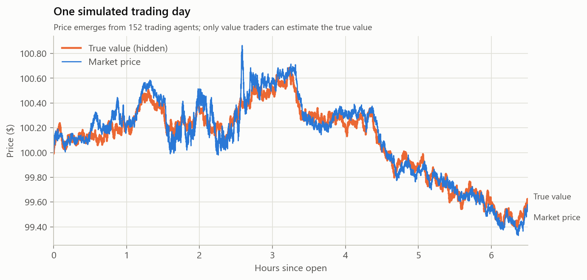
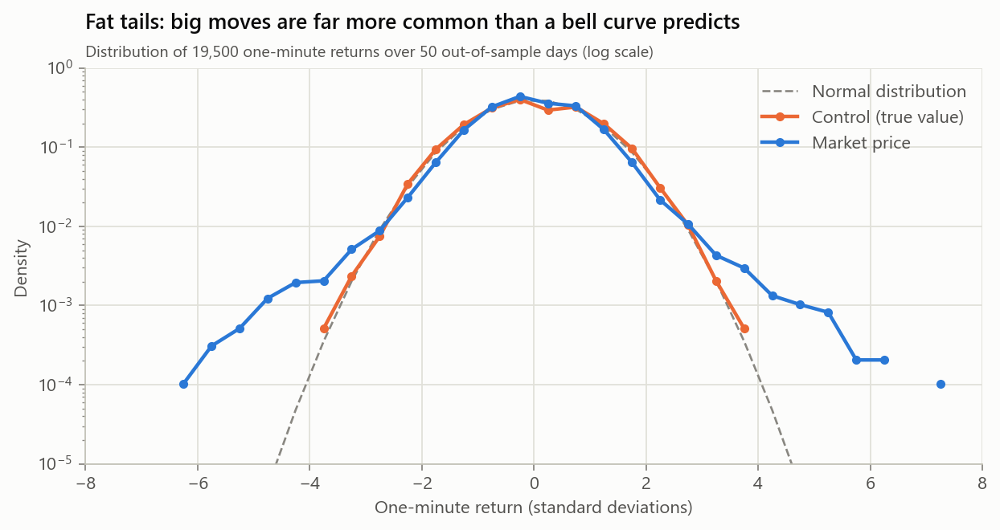
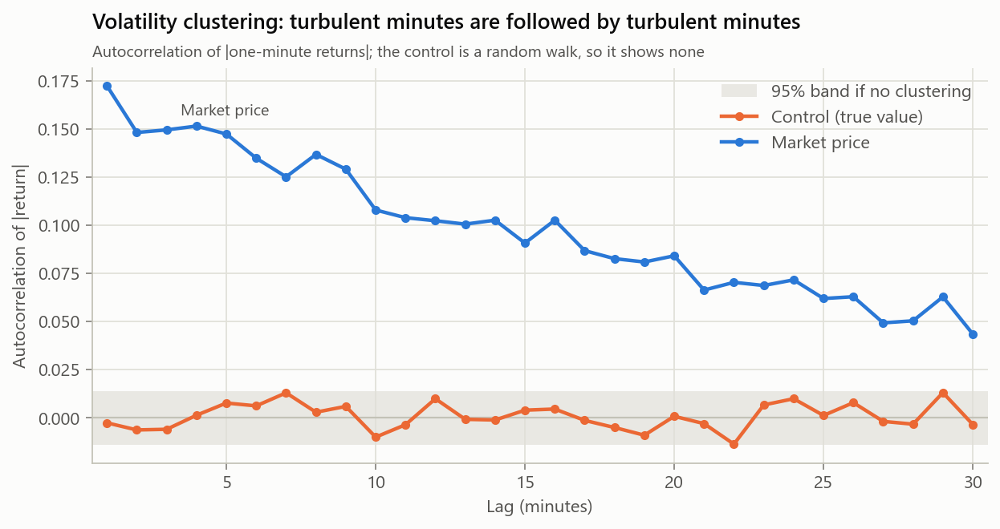

# Validation against stylized facts

Does the simulated market behave like a real one? Real asset returns share a
set of statistical regularities, the **stylized facts** (Cont, *Empirical
properties of asset returns: stylized facts and statistical issues*,
Quantitative Finance, 2001). A credible market simulator must reproduce them
without having them written in.

## Method

- **Data.** 50 simulated trading days (6.5 hours each), analysed as one-minute
  log returns of the mid price: 19,500 returns. Statistics are pooled across days
  without letting any pair of observations span two days.
- **Out-of-sample.** Parameters were calibrated on seeds 1–20. All results
  below come from seeds 1001–1050, which played no part in calibration.
- **A control.** Every statistic is computed for the hidden fundamental value
  too, rounded to the same half-tick grid as the mid price so that price
  discreteness affects both equally. The fundamental is a Gaussian random walk,
  so any fact the price shows and the control lacks **emerges from agent interaction**.
- **No news jumps.** The fundamental's news jumps are switched off during
  validation, so it cannot inject fat tails. The control's excess kurtosis is
  -0.02: a clean bell curve.
- **Pass rules fixed in code** ([`apps/validate.cpp`](../apps/validate.cpp)) and
  stated below. 95% band for an autocorrelation under independence: ±0.014.

Reproduce with:

```powershell
.\build\release\beaglex_validate.exe --days 50 --seed 1001
python scripts\plot_validation.py
```

## Results

| Stylized fact | Metric | Price | Control | Real markets | Pass rule | |
|---|---|---:|---:|---|---|---|
| No return autocorrelation | max \|ACF\|, lags 1–10 min | 0.030 | 0.017 | ≈ 0 | < 0.1 | ✅ |
| Fat tails | excess kurtosis, 1 min | 3.27 | -0.02 | > 0, often 5–50 | > 1 and > 2× control | ✅ |
| | Hill tail index (top 5%) | 3.60 | 5.56 | 2–5 | in [2, 5] | ✅ |
| Aggregational Gaussianity | kurtosis 1 → 30 min | 3.27 → -0.31 | -0.02 → 0.05 | decreasing | 30 min < half of 1 min | ✅ |
| Volatility clustering | mean ACF of \|r\|, lags 1–10 | 0.140 | 0.001 | > 0, slow decay | > 3× band, lag 10 > band, control < 2× band | ✅ |
| Volume–volatility correlation | corr(volume, \|r\|) per minute | 0.366 | n/a | > 0 | > 3× band | ✅ |

Also observed: **excess volatility** (Shiller 1981). The price's one-minute
volatility (4.8 bp) exceeds the fundamental's (3.9 bp), and lag-1 return
autocorrelation is slightly negative (-0.015), the signature of bid–ask bounce
in real intraday data.







## What causes what: ablations

Each row removes one ingredient from the final model (50 out-of-sample days each):

| Removed | Lag-1 return ACF | Kurtosis (1 min) | \|r\| ACF, lag 1 → 10 | Price vol | Market makers' share | Checks |
|---|---:|---:|---:|---:|---:|---:|
| Nothing (full model) | -0.015 | 3.27 | 0.172 → 0.108 | 4.8 bp | 15.5% | 6/6 |
| Momentum traders | -0.073 | 1.51 | 0.089 → 0.047 | 3.9 bp | 17.1% | 6/6 |
| Self-exciting activity | -0.017 | 0.37 | 0.035 → 0.004 | 5.0 bp | 17.4% | **3/6** |
| Liquidity withdrawal | 0.014 | 2.16 | 0.088 → 0.023 | 4.2 bp | 24.9% | 6/6 |
| Market makers | -0.082 | 1.90 | 0.197 → 0.154 | 7.4 bp | 0% | 6/6 |

- **Self-exciting order flow is the engine.** Noise traders trade more often
  when they observe higher volatility, a simple stand-in for the self-exciting
  (Hawkes-type) order flow documented in real markets. Without it, fat tails and
  clustering disappear.
- **Momentum traders amplify** the tails and add excess volatility.
- **Liquidity withdrawal makes clustering persist.** Market makers widen spreads
  when volatility runs above its norm, so turbulence takes longer to subside.
  Without it, clustering fades within 10 minutes.
- **Market makers stabilise the market.** Removing them raises volatility by
  half and strengthens clustering.

## How the calibration got here

The first version of the model failed this validation (3 of 6 checks), and the
route to a passing model is part of the result.

1. **Predictable trends.** One-minute returns had autocorrelation of +0.44
   lasting about 10 minutes: the market trended predictably, which real markets
   arbitrage away. Ablations traced it to momentum traders feeding on trends and
   to value traders that were too slow (acting on 20 bp mispricings, every 90 s),
   so price followed value with a lag.
2. **Efficient but Gaussian.** Faster, more precise value traders removed the
   predictability but also the fat tails and clustering: the price became a copy
   of the Gaussian fundamental. The model lacked an endogenous source of
   volatility.
3. **Excess volatility.** Lowering the fundamental's volatility (1.5% to 0.8%
   a day) let order flow, rather than news, drive most intraday movement, as in
   real markets.
4. **Two feedback mechanisms** from the market microstructure literature were
   added: volatility-sensitive trading activity and stress-dependent spreads.
5. **A bug in the second mechanism.** The first version had market makers
   sample volatility every 100 ms, which counted half-tick bounces as risk. They
   quoted so wide they all but left the market (8,000 shares a day instead of
   millions), and the resulting "clustering" came from their absence. They now
   sample once a second and widen only relative to their own 30-minute baseline.
6. **Overfitting check.** The final parameters were chosen on seeds 1–20 and then
   tested once on 50 unseen days, along with two neighbouring settings of the
   main feedback parameter (activity sensitivity 8 and 12). All three pass 6 of
   6, so the result does not sit on a knife edge. Kurtosis was lower out of
   sample (3.3) than in sample (5.9). The out-of-sample figure is the one reported.

## Limitations

- **Tails are milder than real.** Kurtosis of 3.3 is fat-tailed, but below the
  5–50 typical of real one-minute returns.
- **Clustering is weaker and shorter.** Real |return| autocorrelation persists
  for days, not tens of minutes. Each simulated day starts fresh.
- **No intraday seasonality**, such as the U-shaped volume profile of real
  trading days.
- **Facts not tested:** the leverage effect and gain/loss asymmetry. The agents
  are symmetric between buying and selling, so the model would not produce them.
- **Calibrated, not estimated.** Parameters were tuned by hand-run sweeps
  against these six checks, not fitted to real market data.
